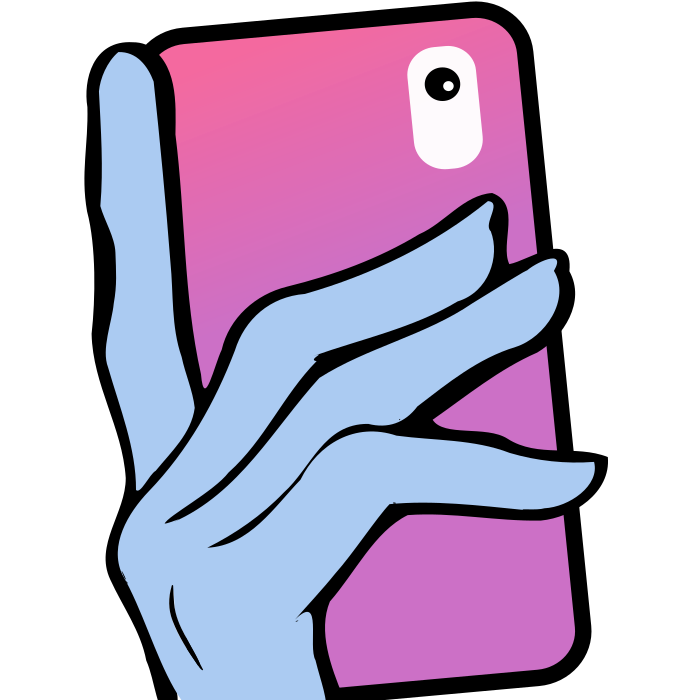
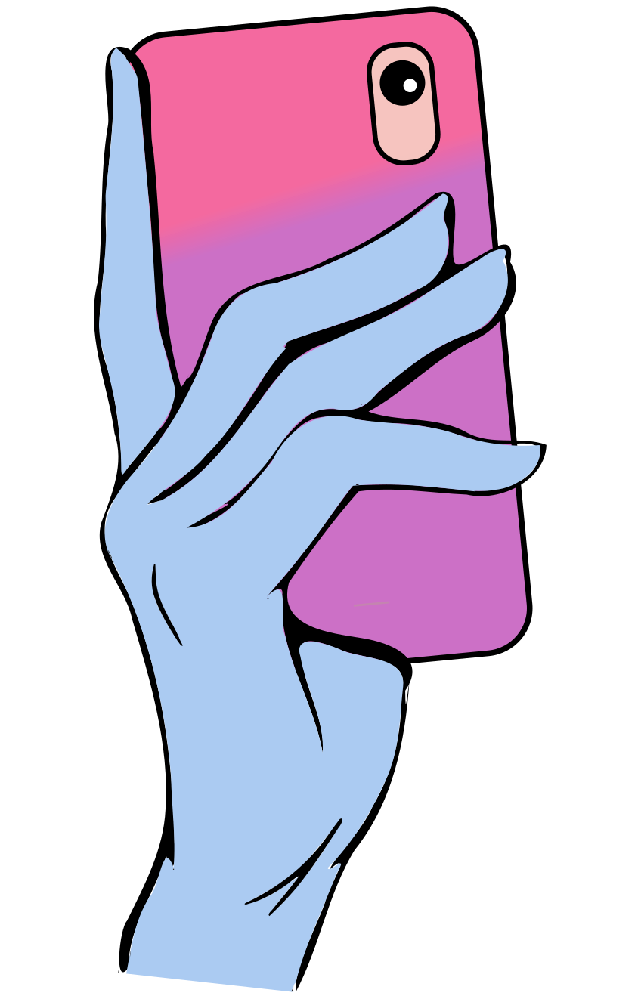
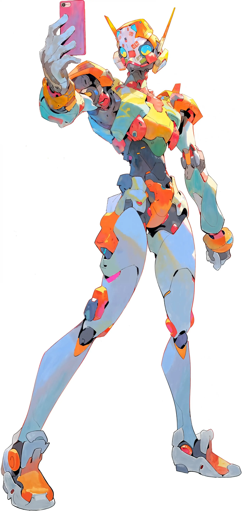

# Selfie branding

The starting kit for this project's identity, carried over unchanged from
`selfie.dev/public/` in the original DiffPlug Selfie repository at commit
`8fd17b8dd1270896d7bd237d4fc82d19a3c39c18`.

| Asset | Use |
|---|---|
| [logo-icon.svg](logo-icon.svg) | Square mark, 700 × 700. Used in the review header, browser tab, and repository README. |
| [logo-icon-large.svg](logo-icon-large.svg) | Tall illustration, viewBox 844 × 1322. For larger placements. |
| [mascot.webp](mascot.webp) | Robot taking a selfie, 2490 × 5232. For illustration and promotional material. |

Keep the SVGs as the editable originals and preserve each asset's aspect ratio.
The UI imports the square mark directly from this folder; Vite gives it a hashed
URL shared by the header and favicon. The larger artwork is not shipped in the
review bundle unless used.

The earlier site's wordmark was live text in **Bagel Fat One**, with a gradient
from blue `#63B9E3` through green `#78ACAE` to red `#E35C61` and a charcoal
`#4D4D4D` shadow. Its body typeface was **Jost**. These are reference choices for
future branding work; this kit does not bundle fonts, and the review UI retains
Primer's typography and light/dark themes.

The original repository distributes these files under Apache-2.0; its license is
preserved in [LICENSE](LICENSE). These are pre-existing branding assets, recorded
in the root README's hackathon disclosure.
